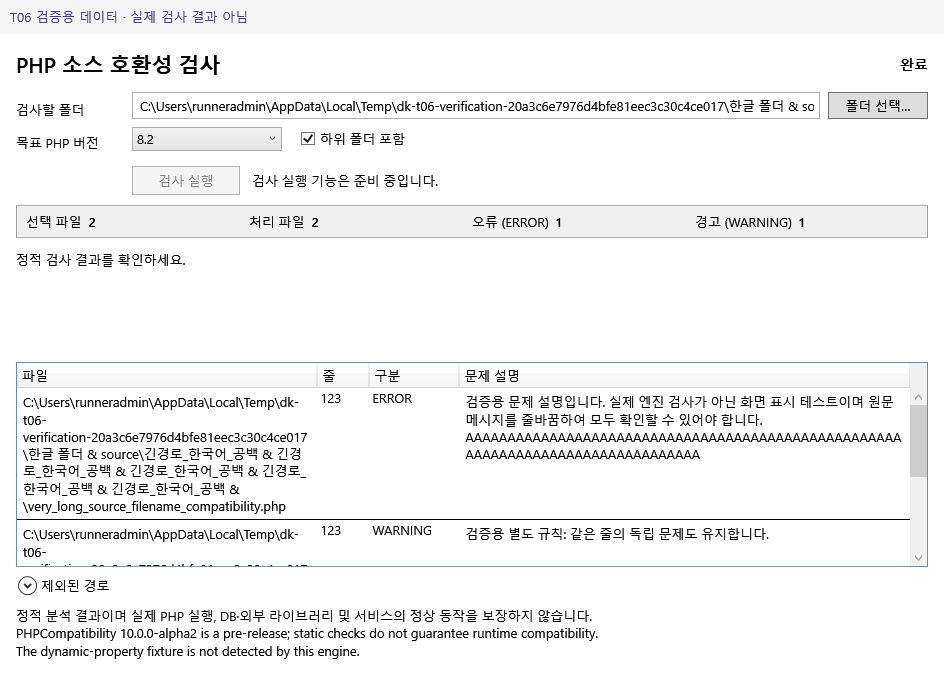

# T06 Windows GUI 검증

새 NuGet/테스트 프레임워크 없이 제품 WPF 프로젝트를 참조하는 검증 전용 콘솔입니다. 실제 Windows x64/SDK 10.0.403에서 실행합니다. 기본 팩은 T04 절차로 준비합니다.

```powershell
dotnet restore tests/t06/T06.Verification.csproj
dotnet build tests/t06/T06.Verification.csproj -c Release --no-restore
dotnet run --project tests/t06/T06.Verification.csproj -c Release --no-build -- $PWD "$PWD/tools/runtime"
```

STA에서 실제 WPF Window를 표시하고 HWND 가시성·프로세스 응답, Dispatcher 처리 뒤의 컨트롤 값과 바인딩을 확인합니다. 실제 팩으로 목표 목록을 로드하되 검사 결과는 자체 작성한 **화면 표시 검증용 데이터**만 주입하며 `ScanService`를 실행하지 않습니다. 초기 목표를 테스트 코드에 고정하거나 새 PHP 지원을 검증한 것으로 표현하지 않습니다.

폴더/목표 입력 제한, 재귀 기본값·입력 잠금, 완료 0건과 NoFiles/실패/부분 결과 구별, 미확인 처리 파일 수, 원문 문제·같은 줄 다른 규칙·한국어 긴 경로/메시지, 제외 경로·한계 안내, 입력 변경 시 이전 결과 초기화, 잘못된 팩/기본 팩 부재, 최소 창 크기와 정상 종료를 검사합니다. 실제 엔진과 버튼의 연결은 T07입니다. 네이티브 폴더 선택 대화상자의 모달 조작은 이 콘솔에서 자동화하지 않으며 제품 코드 검토와 후속 사용자 흐름 검증으로 구분합니다.

PNG는 실제 표시된 WPF client visual을 RenderTargetBitmap으로 저장합니다. OS 창 테두리 대신, 제품 화면을 가리지 않는 상단 여백에 `T06 검증용 데이터 · 실제 검사 결과 아님`을 표시합니다. 제품에 테스트 모드나 임의 표시 옵션을 추가하지 않습니다. `artifacts/t06/summary.json`과 PNG, `T06_SUMMARY_JSON=` 출력이 실제 실행 근거이며 하나라도 실패하면 exit 1입니다. 스크립트 작성만으로 Windows 검증을 완료 처리하지 않습니다.

## 최종 실측

[Windows Actions](https://github.com/danhk0612/DK-PHP-Version-Compatibility-Checker/actions/runs/40966862548)의 Windows Server 2022 x64 / SDK 10.0.403에서 build 경고 0·오류 0, 검증 21건 통과. 검증 head `5cf36d114ea3347999d1568d8d03bc1ecb848bc3`, 실제 checkout merge ref `f70e6448e7d7a214286eca8db76609e0e5ed7ab0`입니다. 캡처 캔버스에 root margin을 포함하고, 최소 크기에서 짧은 상태 자체가 항상 온전히 보이는 고정 헤더와 회귀를 보완한 뒤 전체를 재실행했습니다.

[summary](evidence/summary.json)에 모든 통과 항목·실제 HWND/크기·PNG 9개 SHA-256·미검증 항목을, [provenance](evidence/provenance.json)에 아티팩트/요약 해시를 보존했습니다. 대표 PNG 3개는 Git에 원본 바이트로 보존하고 나머지 PNG 및 build.binlog/dotnet-info는 7일 CI artifact에 있습니다. 후속 문서/실측 보존 커밋은 실행 코드가 같아 재실행하지 않았습니다.

아래 화면은 검증용 데이터이며 실제 검사 결과가 아닙니다.



[부분 실패 화면](evidence/failed-partial.png) · [최소 크기/긴 문구 화면](evidence/minimum-long-diagnostics.png)
