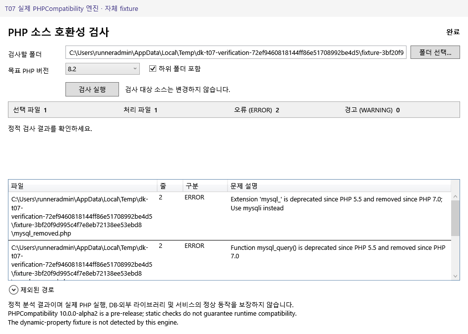

# T07 Windows 실제 검사 GUI 검증

제품 프로젝트를 참조하는 WPF/STA 검증 콘솔입니다. 추가 NuGet·테스트 프레임워크·제품 테스트 모드를 도입하지 않습니다. 실제 Windows x64와 고정 SDK 10.0.403, T04 절차로 준비한 runtime 팩이 필요합니다.

```powershell
dotnet restore tests/t07/T07.Verification.csproj
dotnet build tests/t07/T07.Verification.csproj -c Release --no-restore
dotnet run --project tests/t07/T07.Verification.csproj -c Release --no-build -- "$PWD" "$PWD/tools/runtime"
```

실제 WPF HWND를 표시하고 제품의 폴더·목표·재귀 컨트롤과 ScanButton.Click 경로를 사용합니다. 검증 콘솔이 ScanService를 직접 호출하여 GUI 연결 검증을 대신하지 않습니다. 승인된 팩의 목표 데이터만 소비하며 tests/fixtures/cases.json의 버전별 대표 기대 결과를 실제 PHPCompatibility 결과와 대조합니다.

검증 범위:

- 네이티브 Windows 폴더 선택 대화상자에서 실제 선택·취소와 제품 입력 반영/보존. 별도 작업 스레드가 실제 모달 HWND와 IDOK를 찾고 Win32 입력을 전달합니다. 대화상자 발견·선택은 시간 제한이 있으며 실패하면 닫기를 요청하고 검증을 실패 처리합니다. 사용자 명령어 입력 과정은 없습니다.
- 유효 입력만 실행, 임의 목표 거부, 비동기 검사 중 입력 잠금·재진입 클릭 방어, 실제 목표별 fixture 결과·집계·원문 위치/규칙·grid 항목 일치.
- 정상 0건·빈 폴더·실제 읽기 거부 실패 구분, 재귀·확장자 정책과 입력 변경 시 이전 결과 초기화.
- 한국어·공백·메타문자·긴 경로, 대상 php.ini/phpcs.xml/Composer/bootstrap/autoload와 소스의 실행 차단. 성공·탐지·실패 전후 파일·디렉터리 목록 및 SHA-256 불변.
- 1000개 자체 fixture를 동일 내용의 단일 파일 GUI 검사와 비교합니다. 단일 파일에서 제거된 mysql_query의 2행 탐지를 확인한 후, 파일별 전체 문제 필드(경로 제외)와 총 문제 수를 대조하며 마지막 grid 항목에 접근합니다. 파일 하나가 여러 규칙에 탐지될 수 있으므로 파일 수를 문제 수로 대체하지 않습니다. 소요 시간·Dispatcher 관측 간격·GUI/PHP working set 표본을 기록합니다. 표본 값은 실행 중 구간에 관측한 값이며 OS 전체 최고치나 제품의 보장 성능이 아닙니다.
- 실제 PHP 검사 도중 반복 창 닫기, 해당 자식 PID 종료·작업 폴더 복구·원본 불변. 별도로 팩 로딩 직후 창을 닫아 늦은 서비스 연결과 표시 데이터 게시를 거부하는지 확인합니다. 서비스/프로세스 소유권 확인에는 검증 콘솔 안의 reflection을 사용하며 제품에 진단 API를 추가하지 않습니다.
- 부분 결과는 복사한 테스트 소유 팩의 엔트리를 합성 PHP helper로 교체하고 manifest/근거 해시를 맞춰 실제 버튼을 통과시킵니다. 이 사례는 실제 PHPCompatibility 탐지나 새로운 PHP 지원 검증이 아닙니다. exit255와 유효 JSON의 일부 결과가 Failed로 표시되고, 비정상 종료 때문에 처리 파일 수는 미확인으로 유지되는 연결을 확인합니다.

`artifacts/t07/summary.json`에 실제 환경·팩 ID·목표·사례·실측·네이티브 대화상자 HWND·PNG 해시를 저장합니다. PNG에는 실제 엔진 fixture 또는 합성 도구 출력인지 상단 띠에 명시합니다. 캡처는 표시된 WPF client visual이며 OS 창 테두리를 포함하지 않습니다. 하나라도 실패하면 프로세스 exit1입니다. 실행하지 않은 검증은 완료로 간주하지 않습니다.

이 검증은 Windows Server 2022 CI를 대상으로 하며 깨끗한 Windows 11/CRT·ZIP 배포(T09), 팩 수동 교체/복원(T10), 모든 실제 프로젝트 규모/권한 조합을 검증했다는 뜻이 아닙니다.

## 실측 근거

[Windows 실행](https://github.com/danhk0612/DK-PHP-Version-Compatibility-Checker/actions/runs/41038802788)은 Windows Server 2022 x64 / SDK 10.0.403에서 build 경고·오류 0, 통합 36건 통과입니다. [화면 회귀](https://github.com/danhk0612/DK-PHP-Version-Compatibility-Checker/actions/runs/41038803221)도 build 경고·오류 0, 21건 통과했습니다. 검증 head `ac175da08b2f66d19fd18ca63bde7fc585790a2e`, 실제 checkout merge ref `b33b14f8e21784d9483908328166fc3a34474577`입니다. 이후 문서·증거 커밋은 제품·검증·workflow 실행 코드를 변경하지 않습니다.

1000파일/2000문제는 약 1486.95ms, Dispatcher 최대 관측 간격 54.72ms, GUI/PHP working set 표본 최대 185438208/30769152 bytes였습니다. mysql 확장 제거와 함수 제거의 별도 문제를 동일 줄에서도 유지했고 단일 파일 대조와 파일별 전체 문제·마지막 grid 행 접근을 통과했습니다. 실제 PHP 검사 중 닫기는 약 78.69ms 후 소유 PID 종료·임시 작업 폴더 복구·원본 불변을 확인했습니다. 이 수치는 해당 자체 fixture/CI 관측값이며 보장 성능이 아닙니다.

[evidence/summary.json](evidence/summary.json)과 [회귀 원본 요약](evidence/t06-regression-summary.json), [아티팩트·파일 해시](evidence/provenance.json)를 보존했습니다. 대표 원본 PNG 3개를 Git에 보존하고 모든 PNG/빌드 binlog/dotnet-info는 7일 CI artifact에 있습니다. 최초 실행에서 잘못 둔 단일 문제/처리 수 예상값은 실제 엔진 다중 규칙과 기존 비정상 종료 계약에 맞게 보완한 뒤 전체를 재실행했습니다.

아래는 실제 PHPCompatibility 엔진이 자체 fixture를 검사한 화면입니다.



[1000파일/2000문제의 마지막 행](evidence/real-engine-large-1000.png) · [합성 부분 출력 실패(실제 호환성 결과 아님)](evidence/synthetic-partial-failure.png)
